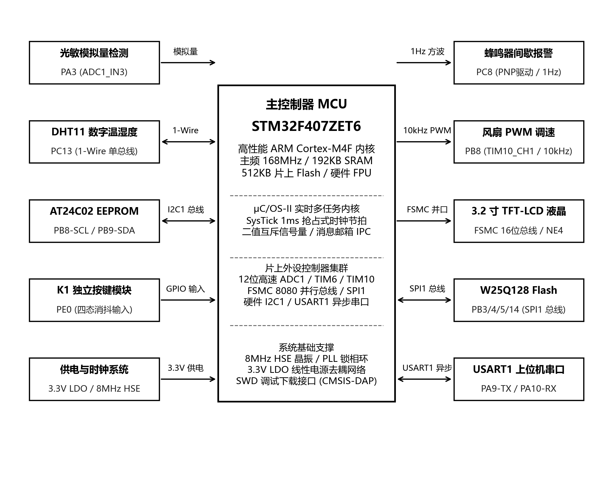
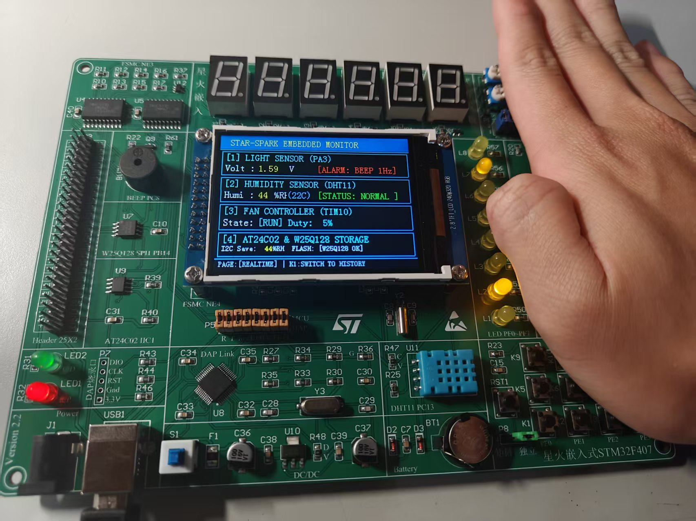
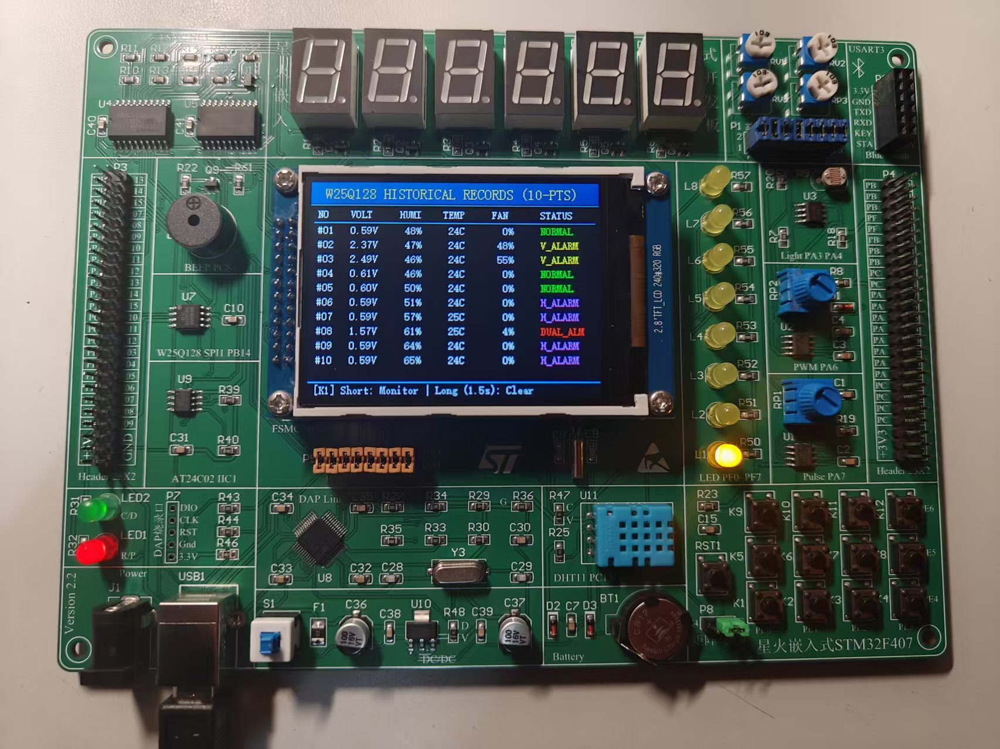

# STM32F407 Multi-Sensor Telemetry & Control System (μC/OS-II RTOS)

An industrial-grade embedded hardware-software co-design project built on **STM32F407ZET6** (ARM Cortex-M4F @ 168 MHz) and the preemptive **μC/OS-II** real-time operating system.



## System Highlights

- **Preemptive RTOS Architecture**: Ported μC/OS-II (`1 ms` tick) with 1 initialization task and 6 orthogonal application tasks synchronized via binary semaphores (`g_sem_data`, `g_sem_storage`), message mailboxes (`g_mbox_ctrl`, `g_mbox_i2c`), and microsecond-level data snapshots (`App_GetSensorSnapshot`).
- **Multi-Bus Sensor & Actuator Integration**:
  - `ADC1` (`PA3`): 12-bit photoresistor voltage acquisition with 1.5 V threshold detection.
  - `TIM6` (`84 MHz` APB1): 500 ms hardware timebase generating a 1 Hz intermittent alarm on `PC8`.
  - `TIM10` (`168 MHz` APB2): 10 kHz hardware PWM linearly mapping $[1.5\,\text{V}, 3.3\,\text{V}]$ to $0\%\text{–}100\%$ fan duty cycle.
  - `DHT11` (`PC13`): 1-Wire digital temperature & humidity sensing protected by `OSSchedLock()`.
  - `AT24C02` (`I2C1`): Non-volatile EEPROM parameter storage with non-blocking `OSTimeDlyHMSM(0,0,0,5)` yield.
- **High-Speed HMI & Persistence**:
  - `ILI9341` 3.2" TFT-LCD over 16-bit `FSMC` 8080 bus with dual-page dashboard and zero-flicker incremental rendering.
  - `W25Q128` 16 MB `SPI1` Mode-3 NOR Flash circular log buffer (`0x00010000`) with 4-state tactile key FSM (`K1`: short press to switch screens, 1.5 s long press to erase history).
  - `USART1` (`115200 bps`): 1-second periodic telemetry frames and MicroLIB `fputc()` boot logging.

## Repository Structure

```text
├── Core/
│   ├── Inc/                # Header files (main.h, peripheral drivers)
│   └── Src/
│       ├── main.c          # RTOS tasks, IPC, FSM, UI, telemetry (1,372 lines)
│       ├── dht11.c         # 1-Wire sensor driver (225 lines)
│       ├── at24c02.c       # Hardware I2C1 EEPROM driver (30 lines)
│       ├── flash.c         # W25Q128 SPI1 Mode-3 NOR Flash driver (291 lines)
│       ├── lcd.c           # FSMC 8080 TFT-LCD graphics driver (1,035 lines)
│       └── stm32f4xx_it.c  # SysTick (HAL + uC/OS-II) & ISR handlers
├── UCOSII/
│   └── port/               # Cortex-M4F FPU port (os_cpu_c.c, os_cpu_a.asm, os_cfg.h)
├── Docs/                   # Hardware schematics, flowcharts, and verification logs
└── README.md
```

## Key Debugging Insights (RCA)

1. **Cortex-M4F FPU & Keil MicroLIB HardFault**: Resolved 64-byte `PSP` stack frame offset mismatch by explicitly activating FPU context (`__set_FPSCR(__get_FPSCR()); __ISB();`) in `OSInitHookBegin()` and enforcing `__align(8)` on all task stacks.
2. **SysTick Timebase Synchronization**: Preserved `HAL_IncTick()` alongside `OSTimeTick()` inside `SysTick_Handler()` to prevent HAL I2C/SPI timeout starvation.
3. **1-Wire Preemption Protection**: Protected the 40-bit microsecond DHT11 capture window with `OSSchedLock()` / `OSSchedUnlock()`.

## Experimental Verification

| Real-Time Dashboard & 1 Hz Alarm | Historical Records (W25Q128 Flash) |
| :---: | :---: |
|  |  |

## Technical Report

Full architectural analysis, mathematical derivations, schematics, and live experimental results are published at:
- **Academic Blog**: [https://academic.czlserver.top/blog/2026/stm32f4-ucosii-multisensor-system/](https://academic.czlserver.top/blog/2026/stm32f4-ucosii-multisensor-system/)
